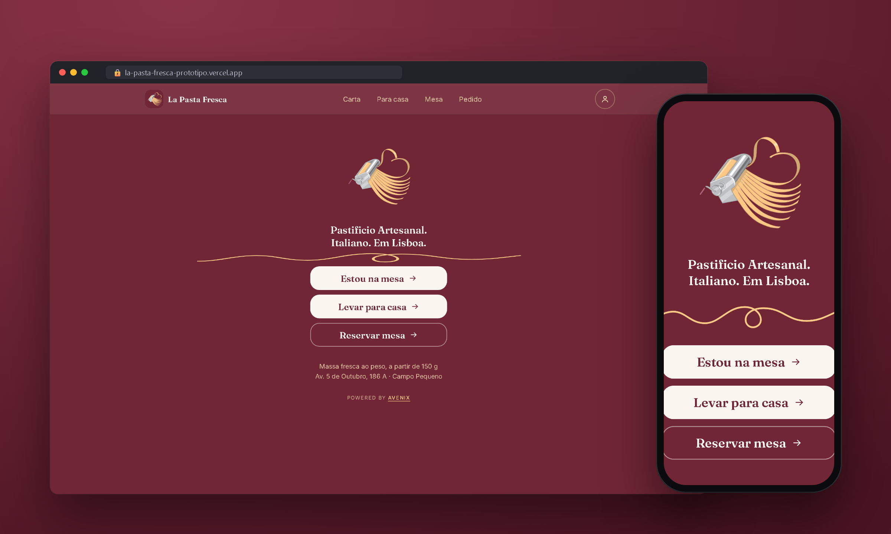
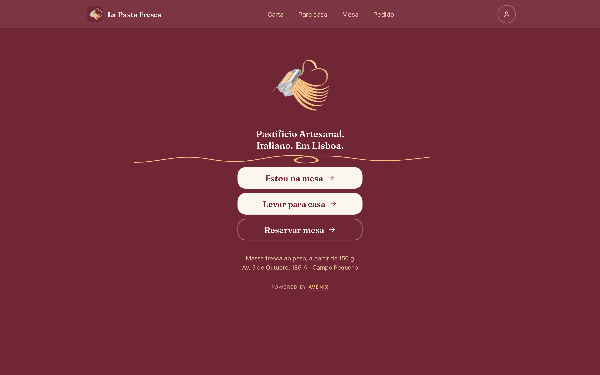
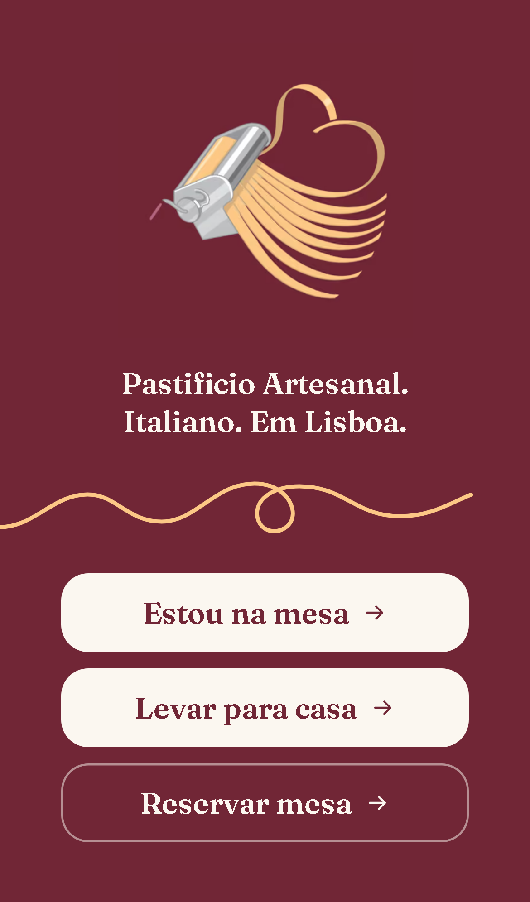
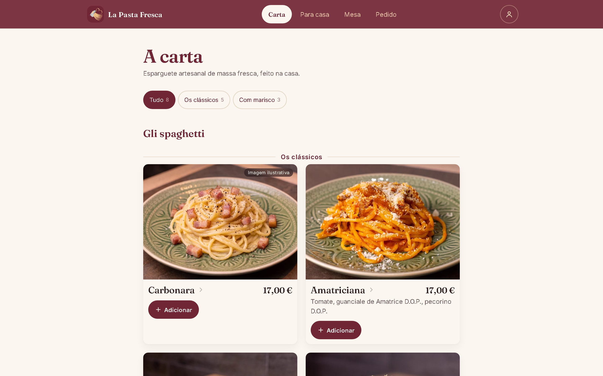

# La Pasta Fresca · Digital Menu Prototype

Digital menu and ordering prototype for La Pasta Fresca, an artisan pasta restaurant in Campo Pequeno, Lisbon.

 

## Highlights

- **Three entry points:** order at the table, take home, or book a table.
- **Menu with photos** and fresh pasta sold by weight.
- **Custom visual identity:** brand illustration, serif typography and a warm palette.

## Screenshots

| Desktop | Mobile | Menu (desktop) |
|---|---|---|
|  |  |  |

## Stack

 

## My role

Full-stack development: requirements, UI, front-end, back-end, deploy and support in production.

## Source code

The source code is private because it belongs to the client. I am happy to walk through the architecture and the code in an interview.

---

Built by **[Erick Rodrigues](https://github.com/Erickrodrigues05)**, Full-Stack Developer · erickrodrigues781@gmail.com
